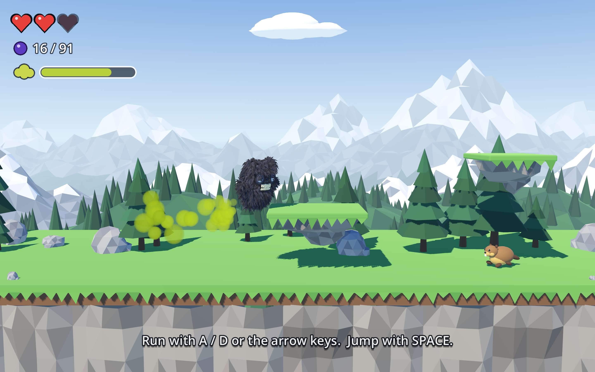

# Toots: Monster of the Rockies

A 2.5D side-scroller made with Godot 4 and Blender. Toots is a shaggy black
monster with magnificent teeth who lives in the Rocky Mountains. He runs, he
jumps, and when a jump isn't enough he farts his way a little higher.

## Play

    flatpak run org.godotengine.Godot --path .

(or open the folder in the Godot editor and press F5)

| Action            | Keyboard                              | Gamepad        |
|-------------------|---------------------------------------|----------------|
| Run               | A / D or arrow keys                   | stick / d-pad  |
| Jump              | Space, W, Up or Z                     | A              |
| Fart-fly          | press and hold jump again in mid-air, or hold Shift / X / F | X or RB |
| Restart           | R                                     | Back           |
| Music on/off      | M                                     |                |

The gas gauge (top left) drains while you fly and refills when you land.
A can of beans refills it instantly, even in mid-air. Stomping a critter gives
a little gas back too.

Reach the flag on the summit. Huckleberries are optional but delicious.

**The locals:** beavers (stomp them), bighorn rams (they charge; stomp them),
bald eagles (stomp them, if you can get above one) and porcupines (do NOT stomp).

## Layout

    scenes/main.tscn     one node; everything else is built in code
    scripts/level.gd     the level: ground, ledges, enemies, pickups, hints
    scripts/player.gd    movement, fart flight, gas, cloud particles, animation
    scripts/enemy.gd     critter behaviour
    scripts/world.gd     sky, haze, mountain backdrop, level geometry
    scripts/main.gd      game flow, camera, pickups, checkpoints, UI
    scripts/hud.gd       hearts / berries / gas gauge
    models/*.glb         exported from Blender
    audio/*.wav          synthesized by tools/make_sounds.py
    blender/             the scripts that build every model

To change the level, edit the tables at the top of `scripts/level.gd`.
To tune how Toots moves (jump height, fart duration...), edit the constants at
the top of `scripts/player.gd`.

## Rebuilding the art and sound

Every model is generated by a Blender Python script, so they can be tweaked
and rebuilt:

    flatpak run org.blender.Blender -b --python-exit-code 1 --python "$PWD/blender/build.py" -- hero
    flatpak run org.godotengine.Godot --headless --path . --import

Leave off the name to rebuild everything. Each build also writes a preview
render to `blender/preview/` and an editable `.blend` to `blender/blend/`, if
you'd rather sculpt by hand and export a `.glb` over the top.

    python3 tools/make_sounds.py     # regenerates all the sound effects and music

## Packaging and releases

Two ways to hand the game to someone on Linux who doesn't have Godot:

    tools/export.sh          # build/toots.x86_64, a standalone executable (about 76 MB)
    tools/build_flatpak.sh   # build/toots.flatpak, a single-file flatpak (about 22 MB)

`tools/export.sh` needs the Linux export template for your Godot version. If
Godot complains it is missing, fetch just that one template (about 70 MB
instead of the full 1.3 GB set):

    tools/fetch_export_template.py 4.7.2 ~/.var/app/org.godotengine.Godot/data/godot/export_templates

(use `~/.local/share/godot/export_templates` for a non-flatpak Godot).

`tools/build_flatpak.sh` needs `flatpak-builder`, or the `org.flatpak.Builder`
flatpak, and packages the executable made by `tools/export.sh`. The flatpak
files live in `flatpak/`: the manifest, desktop entry, AppStream metadata and
icons. The app ID is `io.github.tsloughter.Toots`.

To install and run a bundle:

    flatpak install --user toots.flatpak
    flatpak run io.github.tsloughter.Toots

**Releases:** pushing a tag that starts with `v` runs
`.github/workflows/release.yml`, which builds both and attaches them to a new
GitHub release:

    git tag v1.0.0 && git push origin v1.0.0

The icon is a Blender render of Toots; `tools/make_icon.sh` rebuilds it.

## Scripted test run

    flatpak run org.godotengine.Godot --path . -- --shots="$PWD/.shots" --start-x=56 --secs=6

plays the game with canned input, saves a screenshot every half second and
prints Toots's state, then quits. `--moves=run,jump,fart` picks the inputs.
`--every=0.1` takes the screenshots more often, which helps when checking an
animation (add Godot's own `--time-scale 0.3` before `--path` for slow motion).
